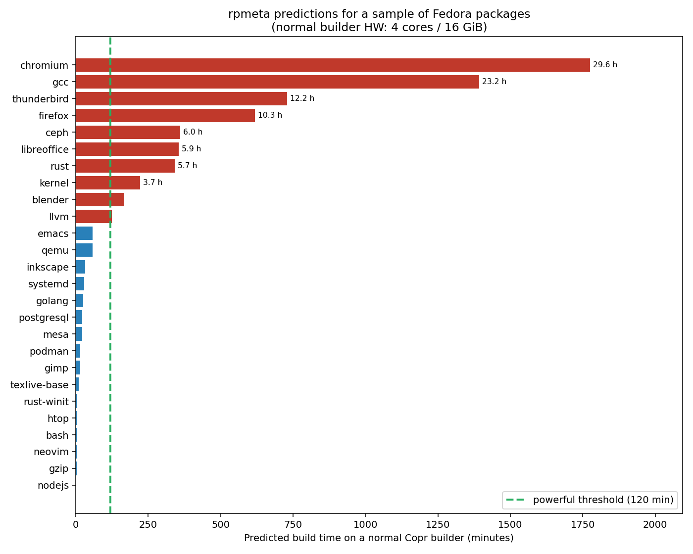
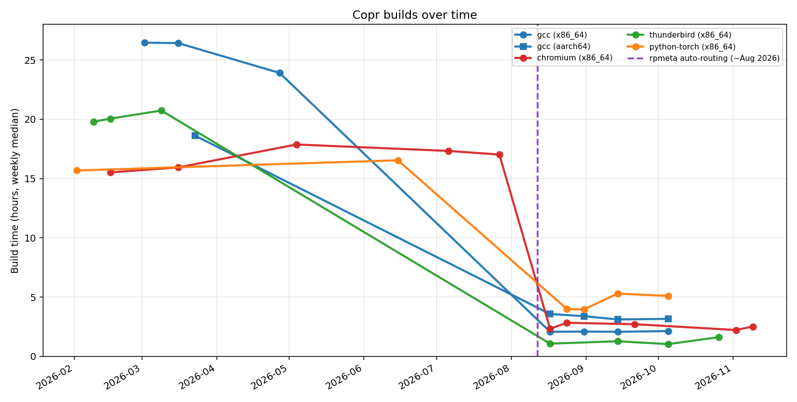

Assigning [high-performance builders](https://docs.copr.fedorainfracloud.org/user_documentation/powerful_builders.html)
used to be manual. You asked us, we configured
it. That is now automatic for typical long-running packages. You can still
request them manually when you need a guaranteed setup.

Behind it is [**rpmeta**](https://github.com/fedora-copr/rpmeta)
(**RPM** **E**stimated **T**ime of (build) **A**rrival): a small model that
estimates how long a build will take. If Copr expects roughly two hours or more
on a normal builder, the job goes to a stronger machine instead.

## What rpmeta is

rpmeta is a XGBoost model that learns from Copr builds how long packages usually
take. The model and training data are published on
[Hugging Face](https://huggingface.co/fedora-copr/rpmeta).

If a package name is completely new to the model, Copr keeps it on a normal
builder rather than guessing.

## How Copr uses it

Before a builder is allocated, Copr asks rpmeta for an ETA. Predictions of
higher than a certain threshold get a high-performance builder. Shorter builds stay on
the normal pool. Existing manual assignments are left alone as rpmeta only adds
a stronger builder when needed, it never takes one away.

## What the model thinks about common packages

Here is a sample of predictions from the production service for well-known
Fedora packages, assuming a normal Copr x86_64 builder. Anything at or above the
green line would get a high-performance machine today:

Browsers and large toolchains dominate the long end, which matches the packages
people used to ask us about by hand. Common packages stay comfortably under
the threshold.

## Looking back at real Copr history

Here is per-chroot build history for a few heavy packages:

Once rpmeta auto-routing kicked in (~August 2026), those multi-hour builds
dropped to a couple of hours on high-performance machines.

## What this means for you

If you maintain a package that usually takes several hours on Copr, you
probably do not need to ask us anymore since August as rpmeta should pick a
stronger builder automatically once the package is known to the model.

If something is still stuck on a slow machine, the package is brand new to the
model, or you want a guaranteed high-performance setup for a specific project,
the
[manual request path](https://docs.copr.fedorainfracloud.org/user_documentation/powerful_builders.html)
is still available.

## Looking ahead

rpmeta is only as good as the build history behind it. Today that is mostly
wall-clock duration with package information with basic hardware facts. We are
also working on a better Mock [`system_monitor`](https://github.com/rpm-software-management/mock/pull/1801)
that collects CPU, memory, I/O and related metrics across the whole build.
Once Copr starts gathering that data, future versions of rpmeta may get a
much clearer picture of which builds are truly heavy, and which builders fit
them best.
